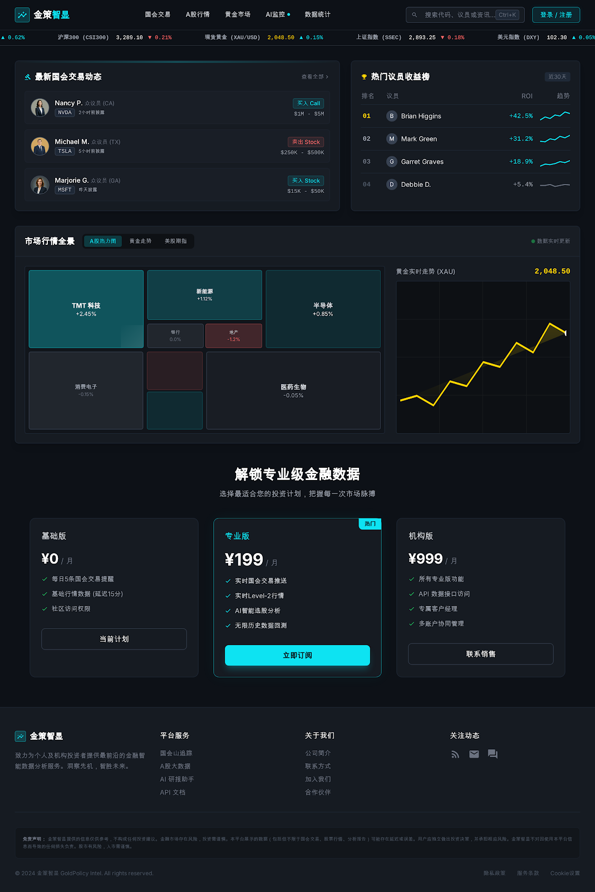
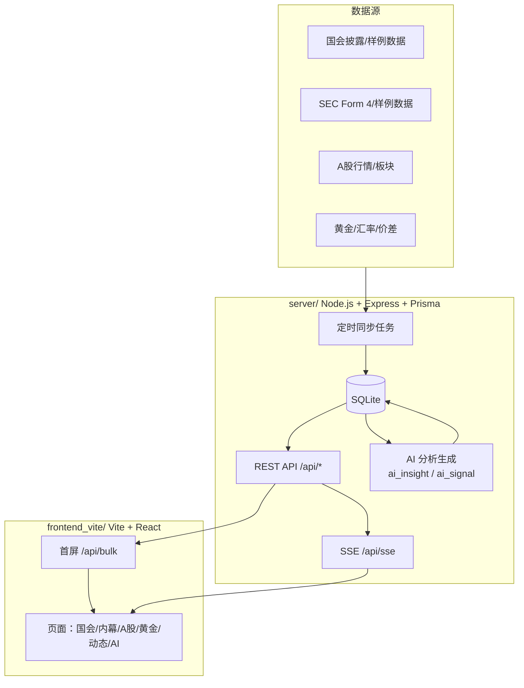

# Golden Agent（金策智显）

Real-time market intelligence for modern investing products.

金策智显是一个端到端的实时市场情报平台：聚合多市场行情与事件流，通过 `/api/bulk` 首屏聚合 + `/api/sse` 实时推送，提供“看盘 + 异动 + 信号”的产品体验。

- 覆盖板块：美国国会交易、SEC Form 4 内幕交易、A 股指数/板块/热股、黄金国内外价差
- AI 分析（不交易只产出）：观点（`ai_insight`）与信号（`ai_signal`）实时流 + Agent 状态面板
- 面向产品工程：前台/后台/数据同步/实时推送一体化，适合作为投研/情报类产品底座

## Demo（示意）

> 下面图片为设计参考稿；如果你放上真实截图/GIF，这一段就是 README 的“门面”。



## 你能做什么（Use Cases）

- 搭建一个实时金融情报看板（聚合多市场数据 + 自动刷新）
- 监控国会/内幕交易异动，并沉淀为可订阅信号
- 作为 AI 辅助投研工作台的底座（只产出观点/信号，不做交易执行）
- 做内部投研/风控工具，或作为 hackathon 原型项目快速迭代

## 核心功能

- **美国国会交易（STOCK Act）**
  - 交易披露列表、议员详情、按党派/议员维度浏览
- **SEC Form 4 内幕交易**
  - 交易明细 + ticker 聚合汇总，便于筛选“异常活跃标的”
- **A 股市场**
  - 指数、板块涨跌、热股榜单与行情概览
- **黄金市场**
  - 国内/国际金价、汇率、价差（套利）展示 + 历史曲线
- **实时动态**
  - 聚合事件流（国会/内幕/基金/游说等）统一呈现
- **AI 分析页（不交易）**
  - Agent 状态、实时分析流、高关注信号，支持“立即分析”触发生成

## 实时能力（Why it feels fast）

- **首屏快**：`GET /api/bulk` 一次返回前台所需聚合数据（避免多次请求瀑布）
- **实时推送**：`GET /api/sse` 推送增量更新，前端自动重连
- **内置同步调度**：后端 cron 定时任务刷新数据并广播

常见 SSE 事件类型（示例）：

- `gold_update` / `gold_daily_update`
- `indices_update` / `sectors_update` / `hot_stocks_update`
- `congress_trades_update` / `insiders_trades_update`
- `ai_status_update` / `ai_insights_update`

## 架构图（High-Level）



## 快速开始（Windows 推荐）

直接运行项目根目录的 `start.bat`：

- 自动安装依赖
- 初始化数据库（Prisma）
- 启动后端（8000）与前端（3000）
- 自动打开浏览器

## 手动启动

后端（Node.js / Express / Prisma，端口 8000）：

```bash
cd server
npm install
npm run db:push
npm run dev
```

前端（Vite / React，端口 3000）：

```bash
cd frontend_vite
npm install
npm run dev
```

可选：管理后台（若你需要运营/管理能力）：

```bash
cd admin
npm install
npm run dev
```

## 常用地址

- 前端：`http://localhost:3000`
- 后端 API：`http://localhost:8000`
- SSE：`http://localhost:8000/api/sse`
- AI 分析页：`http://localhost:3000/ai`

## 关键接口

- `GET /api/health`：健康检查（含各表数据量、SSE 连接数）
- `GET /api/bulk`：首屏聚合数据（前端 DataProvider 使用）
- `GET /api/sse`：实时推送
- `GET /api/search?q=...`：全局搜索

AI（不交易只产出）：

- `GET /api/ai/status`：Agent 运行状态
- `GET /api/ai/insights?limit=50`：AI 事件流
- `POST /api/ai/run`：手动触发一次分析生成

## 技术栈

- 前端：Vite + React + React Router + Radix UI + Tailwind CSS
- 后端：Node.js + Express + TypeScript + Prisma
- 数据库：SQLite（开发），Prisma ORM
- 实时：SSE（Server-Sent Events）
- 图表：Lightweight Charts / Recharts
- 工程化：GitHub Actions 工作流（见 `.github/workflows/`）

## 目录结构（常用）

```text
server/            Node.js 后端（Express + Prisma + SQLite + SSE）
frontend_vite/     用户前台（Vite + React + Router）
admin/             管理后台（可选）
backend/           Python FastAPI（历史/实验用途）
ai-trader-service/ Python AI 服务（实验用途，Windows 下注意保留文件名）
docs/              README 相关素材与说明
```

## 配置与开发提示

- 前端代理：`frontend_vite/vite.config.ts` 里将 `/api` 代理到 `http://localhost:8000`
- 环境变量：
  - 前端可用 `VITE_API_BASE_URL` 覆盖 API 基址（默认 `/api`）
- Windows / Git：
  - **CRLF/LF 警告**：常见换行符提示，一般不影响运行与提交
  - **Windows 保留文件名**：避免创建 `nul`/`con`/`prn` 等文件，否则 `git add` 会失败

## 免责声明（Disclaimer）

本项目仅用于研究与信息展示，不构成投资建议，也不提供自动交易执行能力。
